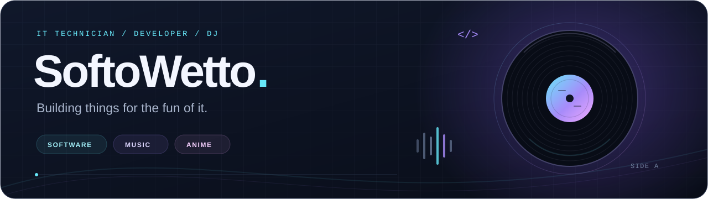

  

<h1 align="center">Hey, I'm Reo 👋</h1>

  Computer science at <b>QUT</b> · DJ at <b>Discus</b> · Building things for the fun of it

  Web apps, music tools, and a little anime along the way. 
  Currently learning more TypeScript and turning ideas into projects I can actually use.

  
  

  <a href="#projects">Projects</a> ·
  <a href="#toolbox">Toolbox</a> ·
  <a href="#university-work">University work</a> ·
  <a href="#lets-connect">Let's connect</a>

---

## Projects

A few things I've been building around music, anime, and useful everyday tools.

<table>
  <tr>
    <td width="50%" valign="top">
      <h3>◈ <a href="https://github.com/Softo-Wetto/omnidl">OmniDL</a></h3>
      
Spotify, YouTube, and SoundCloud in one dashboard. Find matching audio, follow downloads live, and keep a tagged music library.

      
PYTHON · FASTAPI · YT-DLP

      <a href="https://github.com/Softo-Wetto/omnidl">Explore OmniDL ↗</a>
    </td>
    <td width="50%" valign="top">
      <h3>♫ <a href="https://github.com/Softo-Wetto/givememidi">GiveMeMIDI</a></h3>
      
Explore MIDI files, preview tracks, download sheet music PDFs, and build a collection with bookmarks and comments.

      
TYPESCRIPT · MUSIC · SHEET MUSIC

      <a href="https://github.com/Softo-Wetto/givememidi">Explore GiveMeMIDI ↗</a>
    </td>
  </tr>
  <tr>
    <td width="50%" valign="top">
      <h3>✦ <a href="https://github.com/Softo-Wetto/ikAnimeList">ikAnimeList</a></h3>
      
An anime and manga list built with React and TypeScript. A home for the watchlist that keeps getting longer.

      
TYPESCRIPT · REACT · ANIME &amp; MANGA

      <a href="https://github.com/Softo-Wetto/ikAnimeList">Explore ikAnimeList ↗</a>
    </td>
    <td width="50%" valign="top">
      <h3>✓ <a href="https://github.com/Softo-Wetto/getitcertified">GetItCertified</a></h3>
      
A study hub for cloud, networking, and cybersecurity certification exams, bringing preparation into one place.

      
TYPESCRIPT · CLOUD · CERTIFICATIONS

      <a href="https://github.com/Softo-Wetto/getitcertified">Explore GetItCertified ↗</a>
    </td>
  </tr>
</table>

## Toolbox

  
  
  
  
  
  
  
  

## University work

<b>A few projects from my QUT coursework</b>

 

| Project | What I worked on |
| :--- | :--- |
| [SafeSync](https://github.com/Softo-Wetto/safesync-app) | A React and JavaScript project for IFB399. |
| [Anime World AWS Cloud](https://github.com/Softo-Wetto/anime-world-awscloud) | An anime website using React and AWS services including EC2, S3, and RDS for CAB432. |
| [MovieFanatics](https://github.com/Softo-Wetto/CAB230---Application) | A React frontend for exploring a movie API, built during CAB230. |

## Let's connect

Have a project idea, a music recommendation, or an anime I should add to the list? 
Find me on [LinkedIn](https://www.linkedin.com/in/reo-o-29a289a5/) or explore [what I'm building on GitHub](https://github.com/Softo-Wetto?tab=repositories).

  Thanks for dropping by. Back to building something fun. ✨

